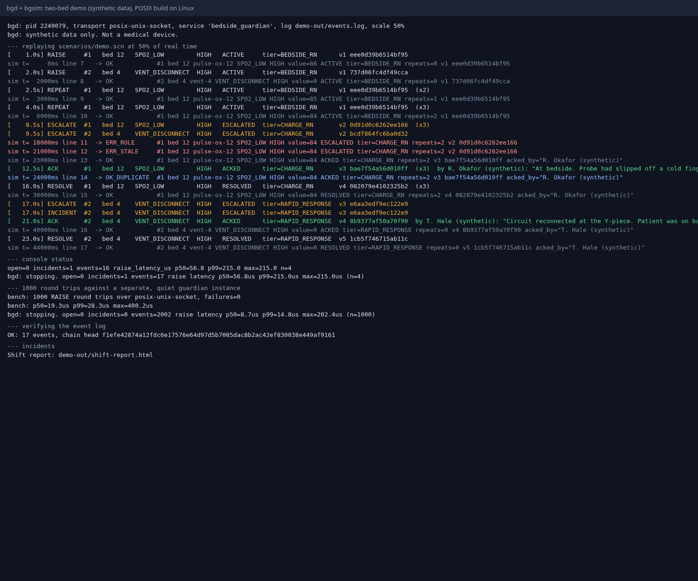
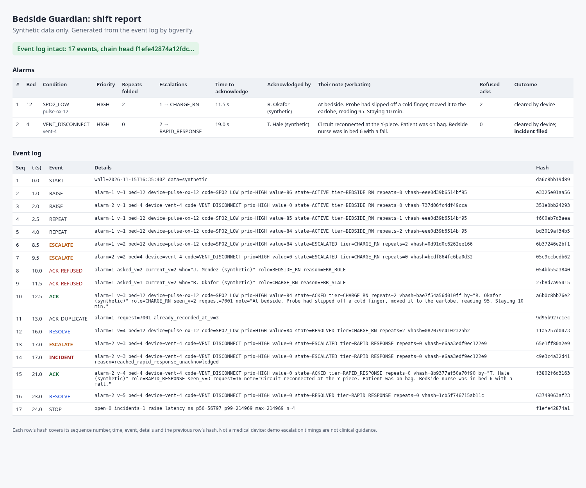
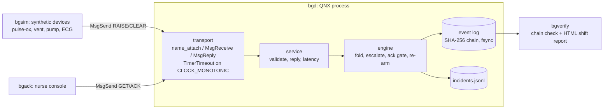

# QNX Bedside Guardian

Sangeeta Sinha | VigilAI Solutions LLC

Bedside Guardian handles alarm escalation and acknowledgement for a hospital unit. It's written in C and runs as a QNX process. Bedside devices (pulse oximeters, ventilators, infusion pumps, ECG monitors) send alarms to it over QNX native message passing. If nobody answers a high-priority alarm, it moves from the bedside nurse to the charge nurse to the rapid response team on fixed deadlines. A person has to acknowledge the alarm by name, and the acknowledgement must match the version of the alarm they were actually shown. Every step goes into an append-only, hash-chained event log. An alarm that reaches rapid response unanswered also becomes an incident record for the unit's safety review.

It's a hackathon project for the QNX Global Hackathon (Robotics & Medical). **Every device, patient, bed and staff name is made up. It is not a medical device and has not been validated for clinical use. The escalation timings are demo values, not clinical guidance.**



## Why it exists

Alarms on a hospital unit fail in a few familiar ways:

- **Too many alarms.** A loose ECG lead or a probe that keeps slipping fires again and again. Staff learn to tune the noise out, and the alarm that matters gets missed with the rest. Alarm fatigue has been a named patient-safety concern for years.
- **No one owns it.** The bedside nurse is in another room with a fall. The alarm keeps sounding at a station nobody is standing at, and there's no rule for when it becomes someone else's job.
- **"Acknowledged" means nothing.** A button press silences the alarm, but there's no record of who pressed it, what they saw or what they did. If the condition is still there five minutes later, nothing brings it back.
- **The review starts from memory.** When something goes wrong, the timeline gets rebuilt from recollection and scattered device logs, and nobody can show the record wasn't changed afterward.

Escalation is a timing problem. A missed deadline is the failure. That's the kind of work a real-time OS is built for, and it's why this targets QNX instead of a general-purpose server.

## What it does

- **Folds repeats.** A repeat from the same bed, device and condition updates the open alarm and adds to its count, so it doesn't create new noise. Repeats don't reset the escalation clock either. A LOW alarm (a lead off, say) never escalates.
- **Escalates on deadlines.**
  - HIGH: 15 s at the bedside, then 15 s with the charge nurse, then rapid response, which is paged again every 30 s until someone answers.
  - MEDIUM: 60 s at the bedside, then it stays with the charge nurse.
  - The windows are a table in `src/alarm.c`. `--scale` shrinks them for demos.
- **Gates acknowledgement on what the person saw.**
  - An acknowledgement carries a name, a role, the alarm's version number and the first 16 characters of its version hash, which is exactly what the console showed.
  - If the alarm escalated or got worse since then, the acknowledgement is refused as stale and the person has to look again.
  - A role below the alarm's current tier can't silence it. Once it's the charge nurse's alarm, the bedside nurse's press doesn't count.
  - The person's note is kept word for word.
  - Every refusal is logged too.
- **Counts each press once.** Each acknowledgement carries a request id. A double tap or a retried message is recorded as a duplicate and changes nothing.
- **Brings acknowledged alarms back.** If the device never reports the condition cleared, the alarm sounds again after a re-arm window (60 s for HIGH). Acknowledging an alarm doesn't make it go away.
- **Keeps a hash-chained event log.**
  - Every raise, repeat, escalation, acknowledgement, refusal, re-arm, clear and incident is one line: `seq|t_ms|TYPE|details|prev_hash|hash`.
  - `bgverify` recomputes the chain and names the first line that was edited, removed or moved.
  - A restarted daemon checks the log before appending, and refuses to extend a broken chain.
- **Hands incidents to the safety review.**
  - When an alarm reaches rapid response unanswered, `incidents.jsonl` gets a record (`unacknowledged_alarm`, patient-safety category) with a plain-language summary and the log head at that moment.
  - Later records add who acknowledged it, with their note verbatim.
  - The shape matches the intake of Clinic Incident Guardian, an earlier project of mine for clinic safety and privacy incidents.
- **Produces a shift report.** `bgverify --html` writes a one-page report: each alarm with its folded repeats, escalations, time to acknowledge, who acknowledged it and their words, refused acknowledgements, and the full log with hashes.
- **Measures latency.** The daemon records the time from a device's `MsgSend` timestamp to the guardian taking it in (CLOCK_MONOTONIC) and reports p50, p99 and max. `bgsim --bench` measures client round trips.



## How it uses QNX

| What | Where |
|---|---|
| Service registered in the QNX path namespace with `name_attach("bedside_guardian")` (appears under `/dev/name/local/`) | `src/transport_qnx.c`, `bg_server_open()` |
| Synchronous request/reply: devices and consoles `MsgSend()`, the guardian `MsgReceive()`s and `MsgReply()`s with the result | `src/transport_qnx.c`, `bg_server_receive()`, `bg_server_reply()`, `bg_client_call()` |
| `_IO_CONNECT` from `name_open()` accepted, disconnect pulses cleaned up with `ConnectDetach()` | `src/transport_qnx.c`, `bg_server_receive()` |
| Escalation deadlines kept by bounding each `MsgReceive()` with `TimerTimeout(CLOCK_MONOTONIC, _NTO_TIMEOUT_RECEIVE, ...)` | `src/transport_qnx.c`, `bg_server_receive()`; deadline from `bg_next_deadline()` in `src/alarm.c` |
| Message layout puts a 16-bit type below `_IO_BASE` first, so our messages can't be confused with resource-manager messages | `include/bg/proto.h` |
| Receive loop optionally `SCHED_FIFO` (`--rt`) and `mlockall()` (`--lock`) | `apps/bgd.c` |
| No heap use in the message path: a fixed alarm table, bounded work per message | `src/alarm.c` |
| `qcc` cross-build for x86_64 or aarch64le | `Makefile` (`QNX=1`), `qnx/build-qnx.sh` |
| Deploy and on-target run scripts | `qnx/deploy.sh`, `qnx/on-target.sh` |

Message passing fits here for a reason. A device's `MsgSend()` blocks until the guardian replies, so the device *knows* its alarm was taken in. The QNX kernel also runs the receiving thread at the sending thread's priority, so a high-priority alarm sender is served at its priority, ahead of lower-priority traffic.

The same code also builds against a POSIX socket transport (`src/transport_posix.c`). That's how it's developed and tested on Linux in CI, and it can be built on QNX with `TRANSPORT=posix` for a side-by-side comparison.

## Architecture



| Part | Where | Notes |
|---|---|---|
| Engine | `src/alarm.c`, `include/bg/alarm.h` | pure logic; time is passed in, so tests need no clock |
| Event log | `src/eventlog.c` | append, verify, reopen-and-continue |
| SHA-256 | `src/sha256.c` | FIPS 180-4, no dependency; tested against the standard vectors |
| Service | `src/service.c` | wire message to engine call; console view; incident records; latency stats |
| Transports | `src/transport_qnx.c`, `src/transport_posix.c` | same interface (`include/bg/transport.h`) |
| Scenarios | `src/scenario.c`, `scenarios/` | timed scripts; offline runner with simulated time |
| Programs | `apps/` | `bgd`, `bgsim`, `bgack`, `bgverify`, `bgscn` |

## Running it

### On Linux (development)

```sh
make            # builds everything into build/
make check      # 48 unit and scenario tests, end-to-end run, QNX type-check
make demo       # two-bed demo at half speed, writes demo-out/ (about 30 s)
```

By hand:

```sh
./build/bgd --scale 50 &                      # guardian, windows at half length
./build/bgsim --speed 50 scenarios/demo.scn   # replay the night shift
./build/bgack --status
./build/bgack --get 1
./build/bgack --ack 1 --who "R. Okafor (synthetic)" --role CHARGE_RN --note "At bedside."
./build/bgack --shutdown
./build/bgverify bedside-guardian.log --html report.html
```

### On QNX 8.0

**Status: the QNX build hasn't been run yet.**

- The QNX transport is written against the QNX SDP 8.0 documentation.
- CI type-checks it against declaration stubs (`make qnx-typecheck`). That catches typos, nothing more.
- A real `qcc` build needs the SDP, which needs a (free) license download.
- `docs/QNX.md` has the full steps.

In short:

- **QNX version:** QNX SDP 8.0 (QNX Everywhere, non-commercial license)
- **Target:** x86_64 QNX 8.0 under QEMU (quick start image), VMware on Windows, or a Raspberry Pi 5 (`QNX_ARCH=aarch64le`)
- **Toolchain:** `qcc -Vgcc_ntox86_64` (via `make QNX=1`)

```sh
source ~/qnx800/qnxsdp-env.sh
./qnx/build-qnx.sh                     # -> build-qnx-x86_64/
./qnx/deploy.sh <target-ip>            # copies binaries, scenarios, scripts
ssh <user>@<target-ip> 'cd /tmp/bedside-guardian && sh scripts/on-target.sh'
```

## Tests

- **Unit tests** (`tests/test_main.c`, 48 in all):
  - SHA-256 against the FIPS vectors and a million-byte input
  - the log catching an edited, deleted or reordered line, and refusing to reopen a damaged log
  - exact escalation deadlines (14,999 ms: nothing; 15,000 ms: charge nurse)
  - every acknowledgement refusal (no name, role below tier, stale version, wrong hash, already acknowledged, resolved)
  - idempotent presses, re-arm, upgrade, a full alarm table, and service handling of malformed wire messages
- **Locked scenario set** (`scenarios/`): five scripted shifts, each with its expected event log in `scenarios/expected/`. `MANIFEST.sha256` pins both, so a test fails if a scenario or its expected output changes without the manifest being updated on purpose.
- **End to end** (`tests/e2e.sh`):
  - a real daemon over real IPC with windows at 10%, plus a 200-message bench
  - checks for the refusals, the duplicate, the incident with the note verbatim, and a clean chain
  - a one-character edit to the log that `bgverify` has to catch
  - a restart that has to continue the same chain
- **CI** (`.github/workflows/ci.yml`): gcc and clang with `-Werror`, an AddressSanitizer + UndefinedBehaviorSanitizer run, and the demo, with its output uploaded as an artifact.

## Limitations

- **Not run on QNX yet.** Everything above "On QNX 8.0" was built and run on Linux. Until it has been built with `qcc` and run on a QNX 8.0 target, treat the QNX transport as untested code. Latency numbers in this repo come from Linux over a Unix socket. They say nothing about QNX.
- **No real devices.** Alarms come from `bgsim` scripts. A real integration would need device interfaces (for example IEEE 11073 SDC or a vendor gateway), and this has none.
- **The policy is a demo.**
  - The escalation windows, the three tiers and the rule that a lower tier can't acknowledge an escalated alarm are design choices for this project.
  - A real unit would set them from its own alarm management policy.
  - Some units would want the bedside nurse to be able to answer at any tier.
- **The console is a command line.** There's no graphical nurse station. `bgack` stands in for one, and the HTML report is generated after the fact.
- **The log is tamper-evident, not tamper-proof.**
  - Someone who can rewrite the whole file can rebuild a valid chain.
  - Cutting lines off the end leaves a shorter chain that still verifies.
  - To catch either, the head hash has to be recorded somewhere else, such as the incident records (which carry it), a second machine or a printout.
  - Nothing is signed.
- **One process, one thread.** The engine is single-threaded by design. There's no failover, no redundancy and no watchdog. A real system would need those, and QNX offers tools for them (high availability manager, adaptive partitioning) that this project doesn't use yet.
- **No authentication.** The name and role on an acknowledgement are whatever the console sends. A real deployment would tie them to badge or login identity.
- **Not a regulated product.** No risk analysis to IEC 62304 / ISO 14971, and no IEC 60601-1-8 alarm-system conformance. The priority levels borrow the familiar high/medium/low idea and nothing more.

## Data

All data is synthetic. Staff names carry "(synthetic)". Beds, devices and readings are invented for the scenarios.

## License

MIT. See `LICENSE`.
